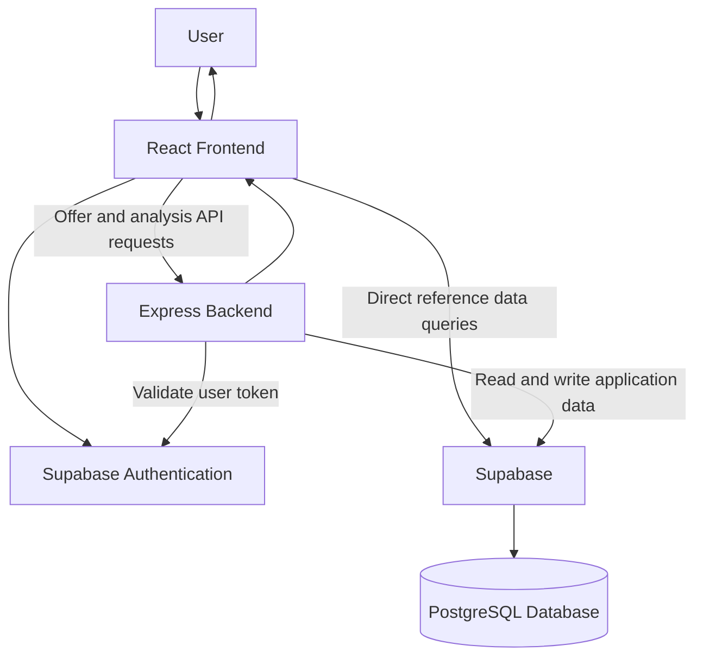

# MoveWise — Smart Job Offer & Relocation Analyzer

MoveWise is a web application that helps users evaluate job offers by comparing their current financial situation with the expected expenses and savings associated with a new job or relocation.

Instead of comparing salaries alone, MoveWise helps users understand how salary, living expenses, existing EMIs, and relocation costs can affect their financial decisions.

## Features

### 1. Job Offers Management
- Add and manage job offers.
- View saved job offers.
- Delete job offers.
- Select a destination city and populate relevant expense fields where city reference data is available.
- Use job offer details as the starting point for financial analysis.

### 2. Scenario Builder
- Adjust financial values to explore different job and relocation scenarios.
- Modify monthly take-home salary, rent, food, transport, utilities, other expenses, and EMI.
- Account for relocation costs, joining bonuses, and relocation assistance where supported.
- Recalculate projected financial outcomes when inputs change.
- Reset scenario inputs to the selected offer's baseline values.

### 3. Financial Analysis
MoveWise compares current financial conditions with a potential job offer to help users understand the financial impact of a career move.

Depending on the inputs, the analysis includes:
- Current monthly savings.
- Projected monthly savings after relocation.
- Monthly savings difference.
- Annualized savings difference.
- Net relocation cost.
- Estimated break-even period.

**Note:** Financial results depend on the entered values and the application's implemented calculation logic. They should be treated as estimates rather than financial advice.

## Technology Stack

| Layer | Technology |
|---|---|
| Frontend | React, Vite |
| Styling | Tailwind CSS |
| Charts | Recharts |
| Backend | Node.js, Express |
| Database | Supabase PostgreSQL |
| Authentication | Supabase Auth |
| API communication | HTTP REST API |
| Language | JavaScript |

*Verify this list against the current project dependencies and configuration before publishing.*

## System Architecture

MoveWise uses a frontend, backend, and database architecture.



### How it works

1. The user interacts with the React frontend.
2. Supabase Auth handles user authentication.
3. The frontend sends offer and analysis requests to the Express backend.
4. The backend validates the user's authentication token and processes the request.
5. The backend communicates with Supabase to access application data.
6. The frontend displays the returned results.

Some reference data, such as city expenses and profile information, may be queried directly from Supabase by the frontend.

## Financial Calculation Logic

The following formulas describe the main financial concepts used by the application. Verify each formula against the current backend implementation before treating this section as an exact specification.

### 1. Current Monthly Savings

```text
Current Savings =
Current Monthly Take-Home
- Current Monthly Expenses
- Current Monthly EMI
```

### 2. Destination Monthly Expenses

```text
Destination Expenses =
Rent
+ Food
+ Transport
+ Utilities
+ Other Expenses
```

### 3. Projected Monthly Savings

```text
Projected Savings =
Offer Monthly Take-Home
- Destination Expenses
- Offer Monthly EMI
```

### 4. Monthly Savings Difference

```text
Monthly Difference =
Projected Savings - Current Savings
```

A positive result indicates higher projected monthly savings. A negative result indicates lower projected monthly savings.

### 5. Annualized Savings Difference

```text
Annual Difference = Monthly Difference × 12
```

This is an annualized estimate based on the monthly difference, not a guarantee of actual yearly savings.

### 6. Net Relocation Cost

```text
Net Relocation Cost =
Relocation Cost
- Joining Bonus
- Relocation Assistance
```

### 7. Break-Even Period

When net relocation cost is positive and monthly savings improve:

```text
Break-Even Months =
Net Relocation Cost / Monthly Savings Difference
```

If the monthly savings improvement is zero or negative, the relocation cost cannot be recovered through increased monthly savings under this calculation. If net relocation cost is zero or negative, no cost-recovery period may be needed under the implemented logic.

**Important:** MoveWise uses user-provided financial inputs. Do not assume that it automatically calculates income tax or incorporates every cost-of-living factor unless those capabilities are implemented separately.

## Project Structure

```text
MoveWise/
├── src/
│   ├── lib/
│   │   └── supabase.js
│   ├── pages/
│   │   ├── JobOffers.jsx
│   │   ├── ScenarioBuilder.jsx
│   │   └── Analysis.jsx
│   └── Dashboard.jsx
├── backend/
│   └── server.js
├── package.json
├── README.md
└── ...
```

This is a simplified view of the important files. Other components, stylesheets, configuration files, and backend modules may also be present.

## Getting Started

### Prerequisites

Install the following:
- Node.js and npm.
- A Supabase project.
- Git, if you are cloning the repository.

### 1. Clone the repository

```bash
git clone <YOUR_REPOSITORY_URL>
cd MoveWise
```

Replace `<YOUR_REPOSITORY_URL>` with the actual repository URL.

### 2. Install frontend dependencies

```bash
npm install
```

### 3. Install backend dependencies

```bash
cd backend
npm install
cd ..
```

Run these commands only if the backend has its own `package.json`.

### 4. Configure environment variables

Create the required environment files based on the variables referenced in the source code.

Frontend `.env` example:

```env
VITE_SUPABASE_URL=your_supabase_project_url
VITE_SUPABASE_PUBLISHABLE_KEY=your_supabase_publishable_key
```

Add the backend environment variables required by `backend/server.js` and the backend's Supabase configuration.

Use placeholder values in documentation. Never commit real credentials, passwords, access tokens, or service-role keys.

### 5. Configure Supabase

1. Create or open your Supabase project.
2. Configure Supabase Authentication.
3. Set up the database tables required by the application.
4. Configure appropriate access policies and permissions.
5. Add the required project URL and keys to your local environment files.

Use the actual database schema and authentication configuration from the project when setting up a new environment.

### 6. Start the backend

From the `backend` directory, run the start command defined in its `package.json`. For example, if a `start` script exists:

```bash
npm start
```

### 7. Start the frontend

From the project root, run:

```bash
npm run dev
```

### 8. Open the application

Open the local URL printed by Vite in your terminal. The default is commonly `http://localhost:5173`, but use the URL shown by your application.

**Setup note:** Confirm the backend port, available npm scripts, environment variables, and Supabase schema from the repository before using these instructions as a guaranteed setup procedure.

## Security Considerations

- Authenticate users before allowing access to protected backend endpoints.
- Validate incoming request data on the server.
- Restrict users to their own application data.
- Configure and verify appropriate Supabase Row Level Security policies.
- Keep service-role keys and other privileged credentials on the server.
- Use environment variables for configuration and never commit secrets.
- Treat client-side validation as a usability feature, not a replacement for server-side validation.

Security measures should be considered verified only after inspecting the relevant code, database policies, and configuration.

## Current Limitations

Potential limitations to verify against the implementation include:
- Financial projections depend on the accuracy of user-entered values.
- Actual living expenses may differ from reference city data.
- Estimated break-even periods do not account for every possible real-world cost.
- Tax calculations and other financial adjustments should not be assumed unless implemented.

## Future Enhancements

Possible improvements include:
- Comparing multiple job offers side by side.
- Saving and revisiting custom financial scenarios.
- Exporting financial comparisons as PDF reports.
- Expanding city expense reference data.
- Adding more detailed tax and cost-of-living estimates.
- Improving automated tests for financial calculations and API endpoints.


## Conclusion

MoveWise aims to make job-offer evaluation more practical by looking beyond salary and considering expenses, savings, and relocation costs. By combining job-offer management with an interactive financial scenario builder, the application helps users explore the potential financial consequences of a career move.

---

**Project:** MoveWise  
**Purpose:** Job-offer comparison and relocation financial analysis  
**Architecture:** React frontend, Express backend, and Supabase  
